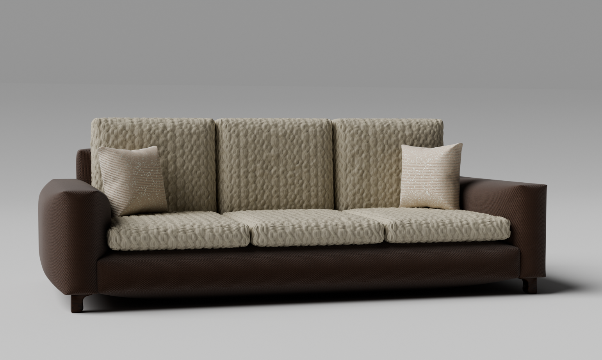
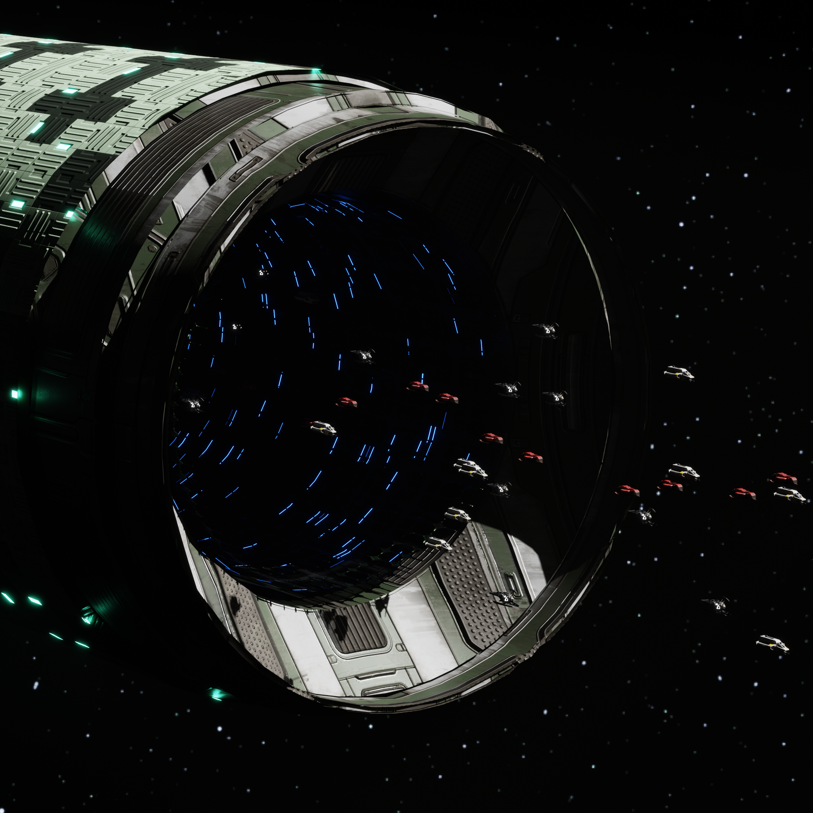
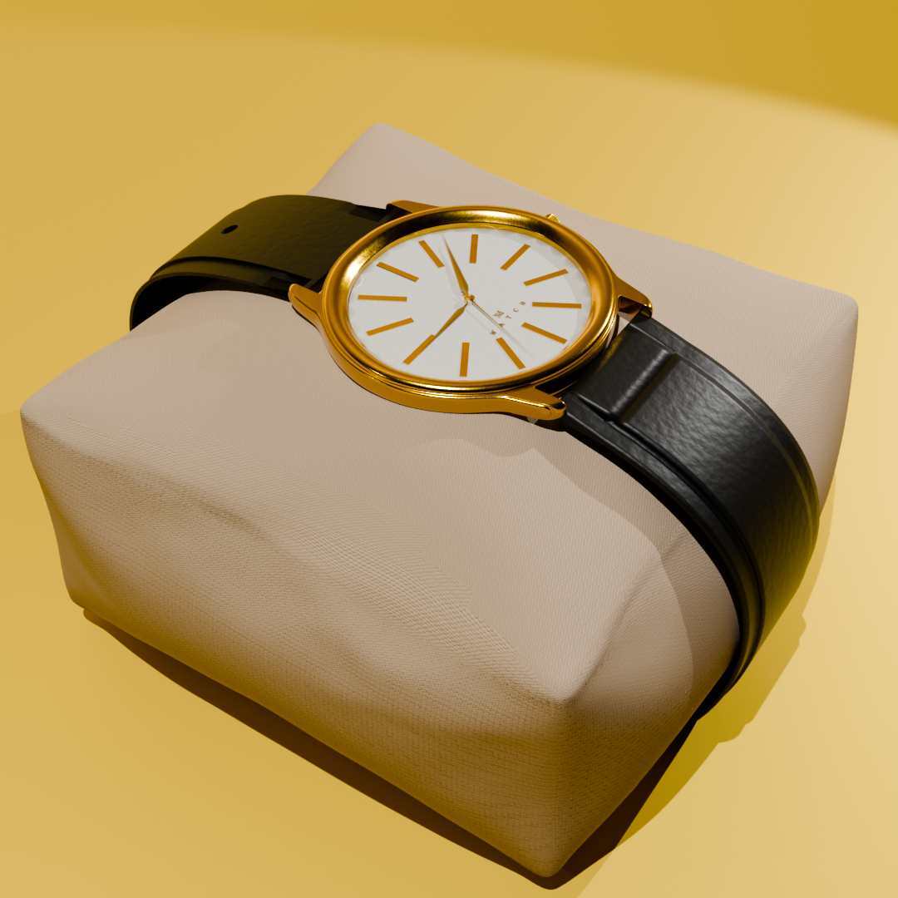
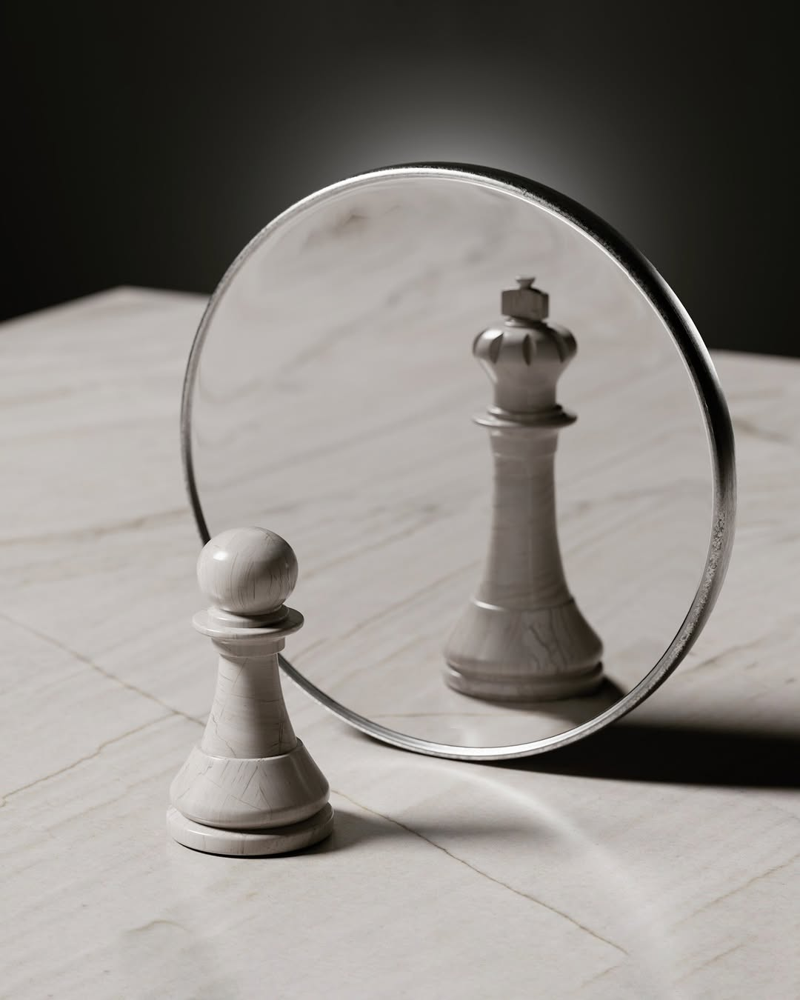
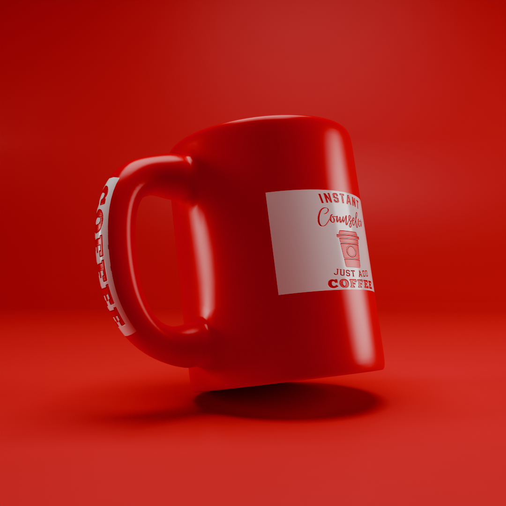
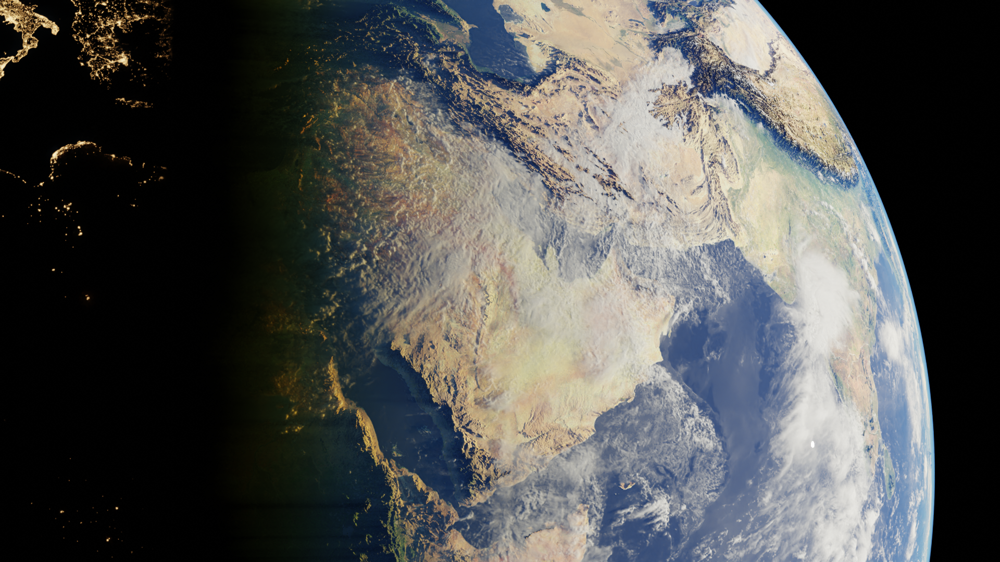
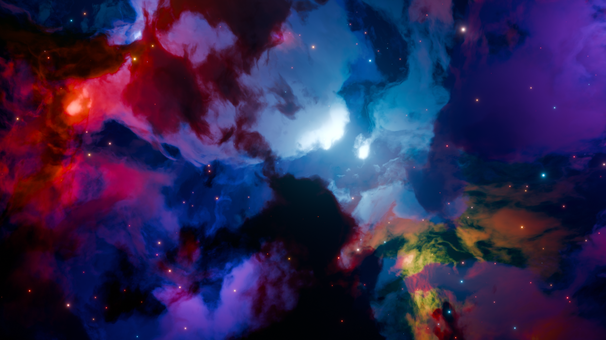
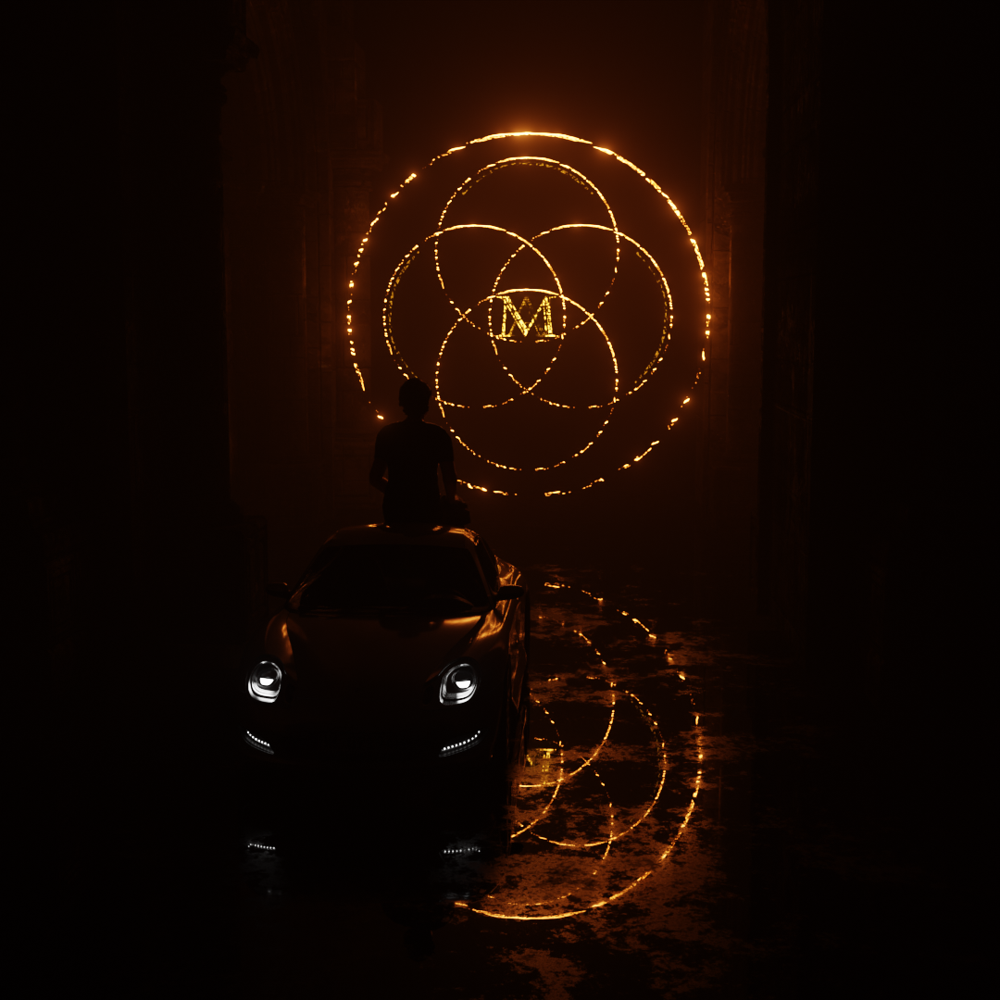
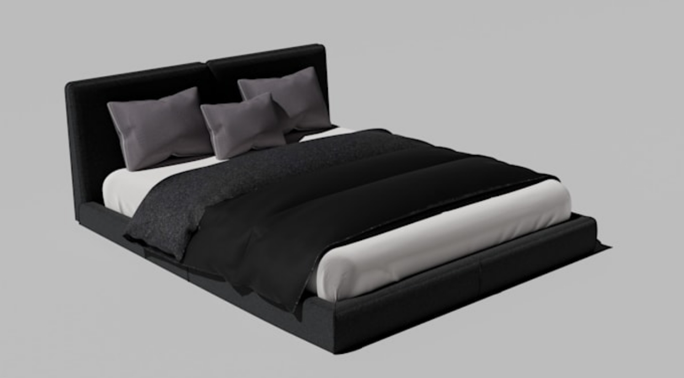

# Blender 3D Projects

A collection of my 3D modeling and rendering projects created using Blender.

## Gallery

### Sofa Set

### Gigantic Space Station

### Watch

### Mirror Reflection

### Coffee Mug

### Earth Surface

### Cosmic Nebula

### Perfume Mockup

### Glowing Logo

### Cozy Bed

## Tools Used

- Blender
- 3D Modeling
- Materials and Texturing
- Lighting
- Rendering
- Product Visualization
- Environment Design

## Author

Md. Mahi
